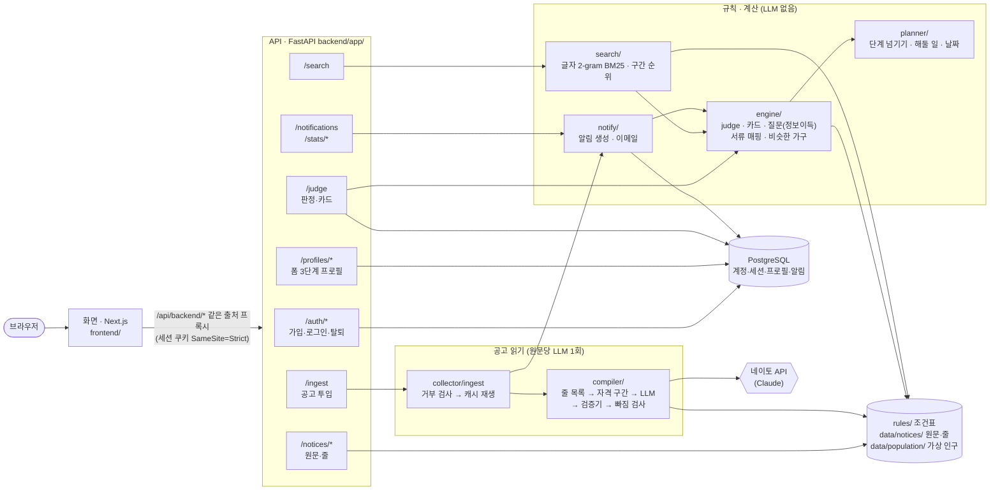
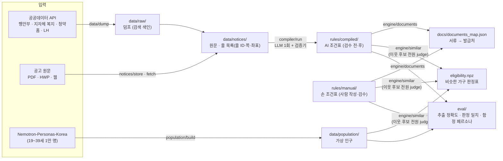

# 징검다리

서비스 이름은 징검다리(줄여서 징검)입니다. 생애주기에 맞춰, 다음 단계에서 열리는 제도를 그 단계가 오기 전에 먼저 보여줍니다. 그 전에 해둘 일과 공고문 원문의 근거까지 보여주고, 원하면 부모님 것도 같이 봅니다.
코디세이 AI 해커톤 2026, 주제 ① AI 기반 추천 서비스.

- 배포: 화면 https://zinggumdari.vercel.app (Vercel), API는 Render. 화면은 `/api/backend/*`를 같은 출처 프록시로 API에 넘긴다
- 왜 만드는가(문제, 근거, 결정과 이유): [Background.md](Background.md)
- 무엇을 만드는가(기능별 동작과 확인 기준): [SPEC.md](SPEC.md)
- 데이터 형식(백엔드, AI, 프론트가 주고받는 모양): [docs/api.md](docs/api.md)
- 외부 자원(빠지면 실격): [docs/external-resources.md](docs/external-resources.md)
- AI 코딩 도구 공통 규칙: [AGENTS.md.example](AGENTS.md.example)
- 역할 분담(누가 어느 폴더를 맡나): [docs/roles.md](docs/roles.md)
- 백엔드2(공고)와 AI 공고 읽기에서 만든 것과 다시 만드는 명령: [docs/backend2-ai.md](docs/backend2-ai.md)

## 폴더

```
.
├── backend/      FastAPI (uv 프로젝트, Python 3.11)
├── frontend/     Next.js
├── rules/        조건 JSON (manual: 손 조건표, compiled: AI 추출)
├── data/         API 덤프(raw), 원문과 줄 목록(notices), 가상 인구(population, 커밋 안 함)
├── eval/         페르소나, 손 조건표 개발·시험 분할, 표본 채점, 결과
└── docs/
```

## 아키텍처

LLM은 공고 원문에서 조건을 뽑을 때(원문당 1회)만 쓴다. 판정, 질문 고르기, 단계·날짜 계산, 알림, 검색 순위는 모두 규칙(코드)이라 같은 입력이면 결과가 같다.

### 요청이 오가는 길 (런타임)



- 판정 대상은 언제나 **세션의 본인 프로필**이다. 사용자 업로드 조건표와 근거 줄은 올린 계정에게만 보인다(`backend/app/sources.py`, docs/api.md 「인증·소유권 계약」).
- 검수 전 AI 조건표는 확정(`eligible`)을 내지 않고, 프로필·다음 단계와 맞는 것만 카드로 올린다. 나머지는 응답 `folded`로 접는다.

### 미리 만들어 두는 것 (오프라인)



- 시연 중에는 공공데이터 API를 부르지 않는다. 런타임은 덤프와 조건표 파일만 읽는다.
- 공고 투입의 시연 PDF는 결과를 원문 해시로 캐시해 두고 「캐시 재생」으로 LLM 없이 돌린다(`data/notices/_ingest_cache/`).

## 준비물

- Python 3.11, [uv](https://docs.astral.sh/uv/)
- Node.js 20 이상, npm
- PostgreSQL 14 이상(CI는 16, 새로 깔면 16 권장): macOS `brew install postgresql@16 && brew services start postgresql@16`, Ubuntu `sudo apt install postgresql`. 가입·로그인·프로필·판정이 DB를 쓴다
- (선택) 스캔 PDF의 줄 좌표가 필요하면 tesseract: `brew install tesseract tesseract-lang`. 없으면 네이토 API가 글자를 읽고 좌표 없이 쪽만 칠한다.

uv가 없으면 먼저 설치합니다(macOS).

```bash
brew install uv
```

## 클론한 뒤 설치

**레포 루트에서** 실행합니다.

```bash
cp .env.example .env
```

```bash
uv sync --project backend
```

```bash
cd frontend && npm install && cp -n .env.example .env.local && cd ..
```

`.env`에 키를 채웁니다. 키는 커밋하지 않습니다. 다른 컴퓨터(서버)로 옮길 때도 git이나 채팅이 아니라 그 컴퓨터에서 직접 넣거나 `scp .env 사용자@서버:레포경로/`로 보냅니다.

| 변수 | 어디서 받나 |
|---|---|
| `CODYSSEY_API_KEY`, `CODYSSEY_BASE_URL`, `LLM_MODEL`, `LLM_MODEL_BULK`, `LLM_MODEL_OCR`(선택), `ZINGGUM_OCR`(선택) | 대회 지급 네이토 API(usr.codyssey.kr API 콘솔). Anthropic 방식 키라 Claude 모델만 쓴다 |
| `DATA_GO_KR_KEY` | data.go.kr 마이페이지의 인증키. 쓰는 API마다 활용신청 |
| `YOUTHCENTER_API_KEY` | 온통청년 마이페이지 > OPEN API 신청(심의 뒤 발급) |
| `SMTP_HOST`, `SMTP_PORT`, `SMTP_USER`, `SMTP_PASSWORD`, `MAIL_FROM` | 이메일 알림 발송 계정 |
| `NEXT_PUBLIC_API_BASE` | 화면이 부를 API 주소. `frontend/.env.local`에 같은 이름으로 둔다 |
| `DATABASE_URL`, `TEST_DATABASE_URL` | 로컬 PostgreSQL 주소(아래 「실행」의 DB 준비). 회원가입과 로그인, 검색 개인화에 필요하다 |
| `COOKIE_SECURE` | 세션 쿠키 `Secure`. HTTPS 배포에서 `1`, 로컬 http 개발에서는 비운다 |
| `CORS_ORIGINS` | 쿠키를 실어 API를 부를 화면 주소(쉼표로 여러 개). 비우면 `http://localhost:3000`. 화면과 API는 같은 사이트여야 한다(docs/api.md 「인증·소유권 계약」) |
| (uvicorn 옵션) `--forwarded-allow-ips` | `.env`가 아니라 실행 옵션(또는 환경변수 `FORWARDED_ALLOW_IPS`). 화면 프록시가 API와 다른 기계면 그 주소를 넣는다. 로컬은 기본값(`127.0.0.1,::1`)이면 된다. 빠지면 로그인 IP 제한이 모든 사용자를 프록시 하나로 센다 |
| `DEV_STUB_API` | 쓰지 않는다. `/profiles`, `/judge`는 로그인 세션과 DB(`DATABASE_URL`)로 열린다. 시연은 가입·로그인 → `POST /profiles/presets/jiwon` 순서다 |
| `ADMIN_TOKEN` | 시연용 관리자 API(`POST /trigger/rebuild`, 헤더 `X-Admin-Token`)를 열 비밀값. 비우면 그 API는 403 |
| `AI_ELIGIBLE` | 검수 전 AI 조건표도 `eligible`을 낼지. 이번 제출은 비운다(SPEC §5.2) |

## 실행

명령은 전부 **레포 루트에서** 실행합니다. uv 프로젝트는 `backend/` 안에 있어서 `--project backend`를 붙입니다. 그래야 `backend.engine` 같은 모듈 경로가 잡힙니다.

DB 준비 (PostgreSQL, 처음 한 번과 `backend/db/migrations/`에 새 파일이 생겼을 때). 스크립트 하나로 끝난다:

```bash
bash backend/db/setup.sh
```

- PostgreSQL이 켜져 있는지 보고, `.env`가 없으면 `.env.example`로 만들고, 비어 있는 `DATABASE_URL`만 `postgresql://localhost/zinggumdari`로 채운다. 이미 있는 값과 API 키는 건드리지 않는다
- DB가 없으면 만들고(`createdb`), 마이그레이션을 적용하고, 몇 개 적용됐는지 보여 준다. 여러 번 돌려도 이미 한 것은 건너뛴다
- 다른 DB 이름은 `bash backend/db/setup.sh 이름`. 사용자·비밀번호가 있는 DB는 `.env`의 `DATABASE_URL`을 먼저 적어 두면 그 주소를 쓴다

손으로 하려면 `createdb zinggumdari` → `.env`에 `DATABASE_URL` → `uv run --project backend python -m backend.db.migrate`.

DB 테스트까지 돌리려면 테스트용 DB를 하나 더 만들고(`createdb zinggumdari_test`) `.env`에 `TEST_DATABASE_URL`을 넣는다. 없으면 DB 테스트는 건너뛴다. 테스트는 그 DB 안에 무작위 스키마(`test_…`)를 만들어 쓰고 끝나면 그 스키마만 지운다(`public`은 건드리지 않는다). CI는 PostgreSQL 서비스를 띄워 DB 테스트까지 돌린다.

API 서버 (http://localhost:8000, 문서는 /docs):

```bash
uv run --project backend uvicorn backend.app.main:app --reload --port 8000
```

화면 (http://localhost:3000):

```bash
cd frontend && npm run dev
```

공공데이터 덤프 (시연 중에는 API를 부르지 않는다):

```bash
uv run --project backend python -m backend.data.dump --source gov24
```

손 조건표의 원문 문장(`quote`)을 근거 줄 ID로 바꾸기(원문 줄 목록이 다시 만들어졌을 때도):

```bash
uv run --project backend python -m backend.compiler.resolve_manual rules/manual/*.json
```

공고 원문 한 건을 AI로 읽기, 정부24 제도 대량 추출(LLM 키 필요. `--cache-only`는 저장된 원응답으로만 다시 조립해 LLM을 부르지 않는다):

```bash
uv run --project backend python -m backend.compiler.run --src data/notices/lh-0000061189.pdf --doc-id demo-1 --source upload
```

```bash
uv run --project backend python -m backend.compiler.gov24_bulk --cache-only
```

원문 등록, 공고 투입 캐시, 검색, 대량 추출의 자세한 내용은 [docs/backend2-ai.md](docs/backend2-ai.md).

가상 인구와 비슷한 가구 표 만들기(없으면 `/judge`의 `similar`가 `null`이다. 판정표는 약 2분):

```bash
uv run --project backend python -m backend.population.build --n 10000 --holdout 1000 --seed 42
uv run --project backend python -m backend.engine.similar
```

시연 데이터: 화면에서 가입(닉네임·필수 동의) → 기본 정보 입력, 또는 로그인 뒤 `POST /profiles/presets/jiwon`(가상 프리셋 「지원」) → `/my`.

테스트:

```bash
uv run --project backend pytest -q
```

화면 검사(타입·린트·API 계약 검사·빌드):

```bash
cd frontend && npx tsc --noEmit && npm run lint && node --test scripts/check-api-contract.cjs scripts/check-auth-validation.cjs && npm run build && cd ..
```

나머지 명령(공고 읽기 배치, 판정만, 채점)도 같은 방식으로 `uv run --project backend python -m backend.<모듈>`로 실행한다.

## 의존성 추가

같은 커밋에서 [docs/external-resources.md](docs/external-resources.md)에 한 줄 추가합니다. 안 하면 CI가 실패합니다.

```bash
uv add --project backend <패키지>
```

```bash
cd frontend && npm install <패키지> && cd ..
```

## 처음 한 번만 (레포를 새로 만들 때)

레포에 `backend/`와 `frontend/`가 이미 있으면 건너뜁니다.

프런트엔드는 **레포 루트에서** 만듭니다. `frontend` 폴더에 들어가서 실행하면 `frontend/frontend`가 생깁니다.

```bash
npx create-next-app@latest frontend --ts --tailwind --eslint --app --no-src-dir --import-alias "@/*" --use-npm
```

원문 PDF 보기는 나중에 `pdfjs-dist`를 더했다(레포에는 이미 있다).

백엔드는 `backend` 폴더를 만들고 그 안에서 uv 프로젝트를 초기화합니다. `--no-package`를 빼면 최신 uv는 `src/` 구조로 만들어 아래 실행 명령과 맞지 않습니다.

```bash
mkdir -p backend && cd backend && uv init --python 3.11 --no-package && cd ..
```

FastAPI와 개발 서버 등 표준 의존성, 그리고 우리가 쓰는 라이브러리를 설치합니다.

```bash
cd backend && uv add "fastapi[standard]" && cd ..
```

```bash
uv add --project backend duckdb numpy olefile openpyxl pandas pdfplumber "psycopg[binary]" pyarrow
```

```bash
uv add --project backend --dev pytest
```

모듈 경로가 잡히도록 패키지 표시 파일을 만듭니다. `uv init`이 만든 `backend/main.py`는 지웁니다.

```bash
touch backend/__init__.py && mkdir -p backend/app && touch backend/app/__init__.py && rm -f backend/main.py
```

마지막으로 [docs/external-resources.md](docs/external-resources.md)에 설치한 것을 적었는지 확인하고 첫 커밋을 합니다. 첫 커밋 시각은 외부 자원 표에 적습니다.
